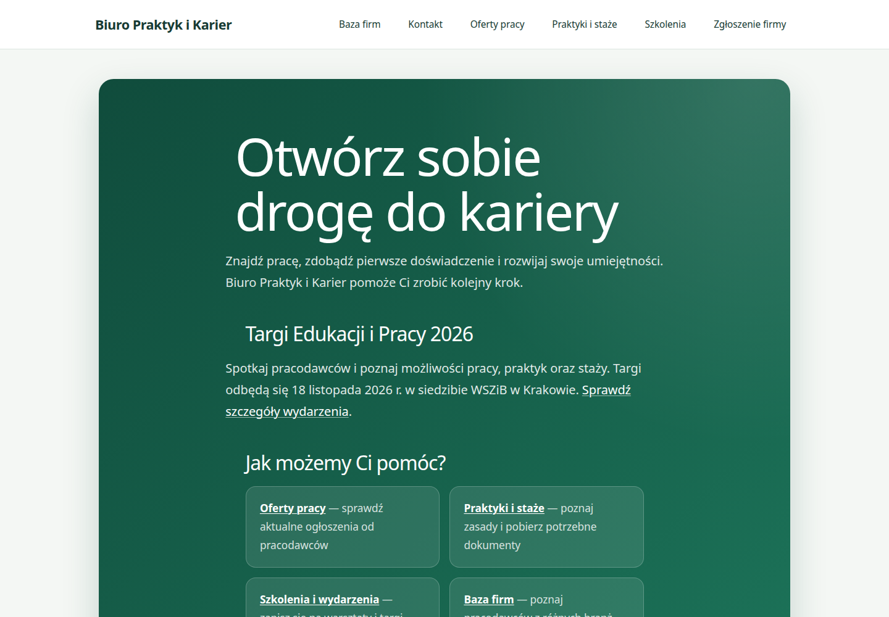
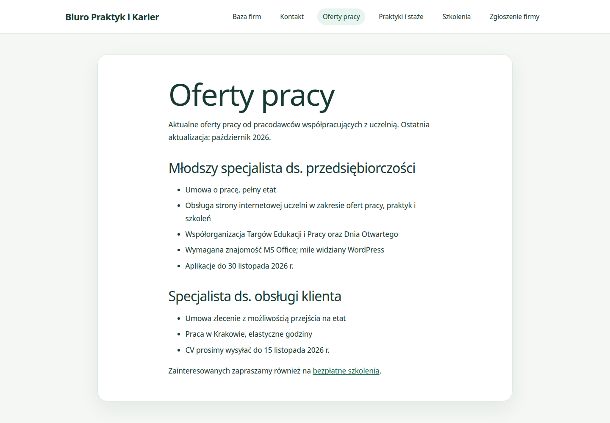
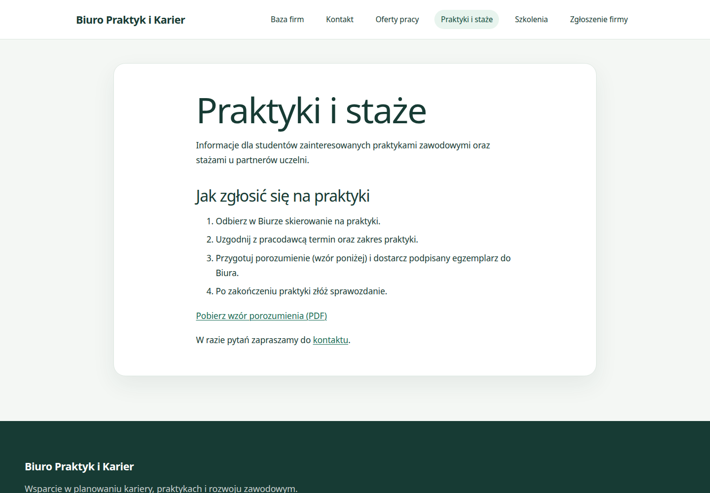
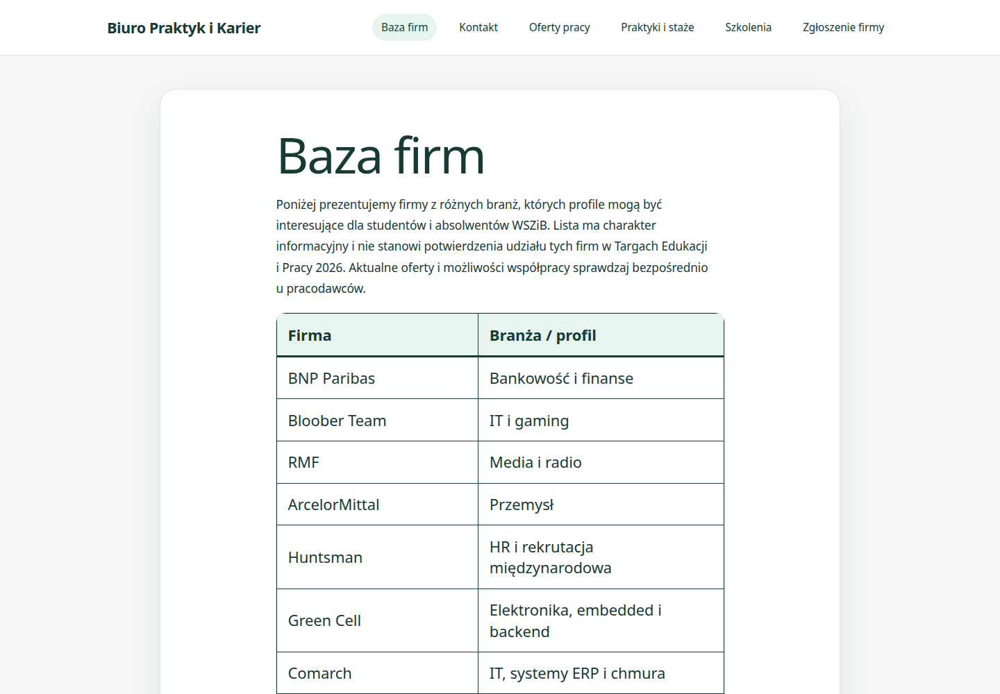
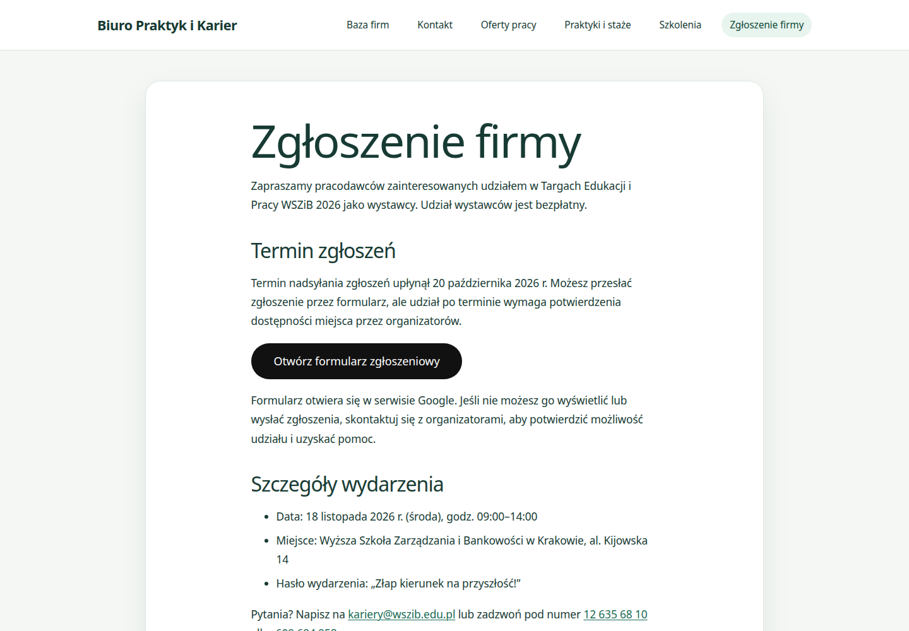

# Strona Biura Praktyk i Karier — demo (WordPress + Docker)

Projekt demonstracyjny: w pełni zautomatyzowana instalacja WordPressa przy użyciu
Dockera i WP-CLI. Pojedyncza komenda uruchamia kompletną stronę z treścią demo
(oferty pracy, praktyki i staże, szkolenia, kontakt) — bez ręcznej konfiguracji.

Projekt towarzyszy aplikacji na stanowisko **Młodszy specjalista ds. przedsiębiorczości**
(BiP — obsługa strony internetowej uczelni, praktyki, szkolenia).

## Zrzuty ekranu

| Strona główna | Oferty pracy |
|---|---|
|  |  |

| Praktyki i staże | Baza firm |
|---|---|
|  |  |



## Co pokazuje ten projekt

- **Docker Compose** — trzy usługi: WordPress, MySQL 8.4 (z healthcheckiem) i WP-CLI,
- **automatyzacja** — WP-CLI instaluje WordPressa, tworzy lub aktualizuje strony
  na podstawie plików źródłowych, importuje przykładowy PDF i ustawia stronę główną,
- **nazwane wolumeny** — dane bazy i pliki WordPressa przeżywają restart kontenerów,
- **ładne linki** (permalinki) konfigurowane automatycznie,
- **własny motyw potomny** — responsywny wygląd dopasowany do strony biura,
- **gotowe wdrożenie** — nakładka produkcyjna z sekretami w `.env` i reverse proxy z HTTPS.

## Wymagania

- Windows: [Docker Desktop](https://www.docker.com/products/docker-desktop/) (z WSL2) albo
  Docker na Linuksie/macOS. Reszty nie trzeba — nawet PHP nie jest wymagany.

## Szybki start

```powershell
git clone https://github.com/mfrondziak-dev/wordpress-biuro-karier.git
cd wordpress-biuro-karier
docker compose up -d
```

Pierwsze uruchomienie trwa ok. 1–2 minuty (pobranie obrazów + automatyczna instalacja).
Postęp instalacji można obserwować poleceniem:

```powershell
docker compose logs -f wp-cli
```

Gdy zobaczysz `OK: treść demo gotowa`, strona działa:

- **Strona główna:** http://localhost:8080
- **Panel administracyjny:** http://localhost:8080/wp-admin
- **Login / hasło:** `admin` / `admin123` *(tylko demo — patrz „Bezpieczeństwo")*

## Co jest w środku

| Strona | Zawartość |
|---|---|
| `/oferty-pracy/` | ogłoszenia o pracę z listą wymagań |
| `/praktyki-i-staze/` | instrukcja krok po kroku + **wzór porozumienia (PDF)** |
| `/szkolenia/` | informacje o Targach Edukacji i Pracy 2026 |
| `/firmy/` | publiczna lista firm i ich branż (bez danych kontaktowych) |
| `/zglos-firme/` | informacje i formularz Google dla wystawców |
| `/kontakt/` | kontakt do organizatorów targów |
| `/` | strona główna ustawiona jako statyczna (Settings → Reading) |

Po zmianie plików w `setup/content/` zaktualizuj istniejącą stronę poleceniem
`docker compose run --rm wp-cli`.

## Przydatne komendy

```powershell
docker compose down        # zatrzymanie (dane zostają w wolumenach)
docker compose up -d       # ponowne uruchomienie (bez duplikowania treści)
docker compose down -v     # pełny reset (usuwa bazę i pliki WordPressa)
```

## Struktura projektu

```
docker-compose.yml        # definicja trzech usług (środowisko demo)
docker-compose.prod.yml   # nakładka produkcyjna (sekrety z .env, port tylko lokalnie)
.env.example              # wzór konfiguracji produkcyjnej
deploy/Caddyfile          # reverse proxy + automatyczny HTTPS
screenshots/              # zrzuty ekranu wykorzystane w README
setup/
  init.sh                 # automatyczna instalacja + zasilenie treścią (WP-CLI)
  content/*.html          # treści stron w formacie bloków Gutenberg
  media/*.pdf             # przykładowy wzór porozumienia
  theme/                  # własny motyw potomny WordPressa
```

Katalog `reference/` zawiera robocze materiały źródłowe (m.in. dane kontaktowe firm)
i celowo nie jest publikowany — jest wykluczony w `.gitignore`.

Jeśli port 8080 jest zajęty: zmień `"8080:80"` na np. `"8081:80"` **oraz** `WP_PORT: "8081"`
w usłudze `wp-cli`, potem `docker compose down -v && docker compose up -d`.

## Wdrożenie na serwer (VPS)

Projekt jest gotowy do uruchomienia na VPS z Dockerem (np. Ubuntu 24.04, 2 GB RAM).
Potrzebne są: domena, otwarte porty 80/443 oraz Docker Compose w wersji **2.24+**
(nakładka używa dyrektywy `!override`).

### 1. DNS i Docker

- W panelu domeny dodaj rekord `A` (np. `kariera.twojadomena.pl`) wskazujący na IP serwera.
- Zainstaluj Docker Engine + Compose plugin wg
  [oficjalnej instrukcji](https://docs.docker.com/engine/install/ubuntu/).

### 2. Kod i konfiguracja

```bash
git clone https://github.com/mfrondziak-dev/wordpress-biuro-karier.git
cd wordpress-biuro-karier
cp .env.example .env
nano .env
```

W `.env` ustaw `WP_URL` (pełny adres z `https://`) oraz **własne, długie hasła**
do bazy i konta administratora WordPressa.

### 3. Uruchomienie

```bash
docker compose -f docker-compose.yml -f docker-compose.prod.yml up -d
docker compose -f docker-compose.yml -f docker-compose.prod.yml logs -f wp-cli
```

Na produkcji WordPress nasłuchuje wyłącznie na `127.0.0.1:8080` — nie jest dostępny
bezpośrednio z internetu. Ruch ma trafiać przez reverse proxy.

### 4. HTTPS (Caddy)

Caddy sam pobiera i odnawia certyfikat Let's Encrypt.

```bash
sudo apt install -y debian-keyring debian-archive-keyring apt-transport-https curl
curl -1sLf 'https://dl.cloudsmith.io/public/caddy/stable/gpg.key' \
  | sudo gpg --dearmor -o /usr/share/keyrings/caddy-stable-archive-keyring.gpg
curl -1sLf 'https://dl.cloudsmith.io/public/caddy/stable/debian.deb.txt' \
  | sudo tee /etc/apt/sources.list.d/caddy-stable.list
sudo apt update && sudo apt install caddy

sudo cp deploy/Caddyfile /etc/caddy/Caddyfile
sudo nano /etc/caddy/Caddyfile    # podmień kariera.example.com na swoją domenę
sudo systemctl reload caddy
```

Firewall (jeśli używasz `ufw`):

```bash
sudo ufw allow OpenSSH
sudo ufw allow 80,443/tcp
sudo ufw enable
```

Masz już Nginx/Apache? Pomiń Caddy i skieruj domenę na `http://127.0.0.1:8080`.
Nie publikuj portu 8080 w firewallu.

### 5. Aktualizacje

```bash
git pull
docker compose -f docker-compose.yml -f docker-compose.prod.yml pull
docker compose -f docker-compose.yml -f docker-compose.prod.yml up -d
docker compose -f docker-compose.yml -f docker-compose.prod.yml run --rm wp-cli
```

Ostatnie polecenie jest idempotentne — odświeża treść stron bez duplikatów.

### 6. Kopie zapasowe

```bash
# baza danych
docker compose -f docker-compose.yml -f docker-compose.prod.yml exec -T db \
  sh -c 'exec mysqldump -uroot -p"$MYSQL_ROOT_PASSWORD" wordpress' \
  | gzip > "backup-$(date +%F).sql.gz"

# pliki (motyw, uploads, ewentualne wtyczki)
docker run --rm -v biuro-karier_wp_data:/data:ro -v "$PWD":/backup alpine \
  tar czf "/backup/pliki-$(date +%F).tar.gz" -C /data wp-content
```

Odtworzenie bazy:

```bash
gunzip -c backup-2026-11-02.sql.gz | \
  docker compose -f docker-compose.yml -f docker-compose.prod.yml exec -T db \
  sh -c 'exec mysql -uroot -p"$MYSQL_ROOT_PASSWORD" wordpress'
```

Warto dodać oba polecenia do crona i trzymać kopie poza serwerem.

### Ważne przy wdrożeniu

- Hasła bazy z `.env` są ustawiane **przy pierwszym starcie** wolumenu MySQL.
  Późniejsza zmiana `DB_PASSWORD` wymaga `ALTER USER` w bazie albo świeżego wolumenu
  (`docker compose down -v`, utrata danych).
- `WP_ADMIN_PASSWORD` jest synchronizowane z `.env` przy każdym uruchomieniu `wp-cli`.
- Przenosisz istniejącą bazę? Ustaw nowy `WP_URL` i uruchom `wp-cli` — adres
  `home`/`siteurl` zostanie zaktualizowany automatycznie.

## Bezpieczeństwo

- dane demo (`admin` / `admin123`) służą tylko do lokalnych testów,
- sekrety trzymaj w `.env` (plik jest w `.gitignore`),
- `docker-compose.prod.yml` wiąże port 8080 do `127.0.0.1` i wyłącza edycję plików w panelu
  (`DISALLOW_FILE_EDIT`),
- HTTPS i nagłówki bezpieczeństwa zapewnia Caddy (`deploy/Caddyfile`),
- regularnie aktualizuj obrazy (`docker compose pull`) i rób kopie zapasowe wolumenów.

## Licencja

Kod projektu udostępniamy na licencji [MIT](LICENSE). Treści demonstracyjne stron
mają charakter przykładowy — przed użyciem komercyjnym zweryfikuj prawa do materiałów
i danych, na których bazują.
